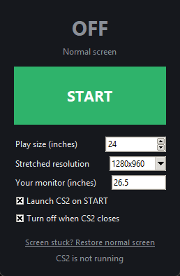

# cs2-24inch

Play CS2 **stretched** (e.g. 1280×960) on a **smaller virtual monitor** — like a 24" esports screen —
on any bigger monitor, with black borders around it. One button turns it on and launches CS2;
your normal desktop comes back when you quit the game.

```
┌──────────────── your monitor ───────────────┐
│ ┌─────────────── 24" area ───────────────┐  │
│ │                                        │  │
│ │     1280×960 stretched to fill it      │  │
│ │                                        │  │
│ └────────────────────────────────────────┘  │
└─────────────────────────────────────────────┘
```

No driver control panels, no registry edits, nothing to install. It uses the Windows display API
(`SetDisplayConfig` with a *desktop image region*): the monitor keeps running at its native
resolution and refresh rate and the GPU scales the picture into the smaller area. Nothing is saved
permanently — a reboot always gives you the normal desktop back.

## Requirements

- Windows 10/11
- [Python 3.8+](https://www.python.org/downloads/) (standard install, no extra packages)
- A GPU driver that supports virtual-mode display paths (tested on NVIDIA RTX 5080)

## Use it

Double-click **`CS2 24-inch.bat`**:



- **START** — shrinks the screen to the play size and launches CS2
- **STOP** — normal screen again (also happens automatically when CS2 closes, and when you close the window)
- **Play size** — the virtual monitor size in inches (24, 24.5, 25, …)
- **Stretched resolution** — 1280×960, 1280×1024, 1440×1080, …
- **Your monitor** — your real monitor size in inches; detected automatically, but monitors report
  it rounded to whole centimetres, so type the exact size from the spec sheet

Works with any monitor size and resolution (27", 32", 4K, ultrawide…). The area is always 16:9
and physically the size you choose:

| Monitor | 24" area | Black borders |
|---|---|---|
| 26.5" 2560×1440 | 2318×1304 | 121 px sides / 68 px top |
| 27" 2560×1440 | 2274×1280 | 143 / 80 |
| 27" 1920×1080 | 1706×960 | 107 / 60 |
| 32" 3840×2160 | 2878×1618 | 481 / 271 |
| 32" 2560×1440 | 1920×1080 | 320 / 180 |
| 34" 3440×1440 ultrawide | 2294×1290 | 573 / 75 |

## CS2 settings

Video → Aspect Ratio **4:3**, Resolution **1280×960** (same as in the app).

- **Fullscreen Windowed** — most reliable.
- **Fullscreen** works too: CS2 resets the layout when it takes over the screen and the app puts it
  back within a second. Pick your monitor's exact refresh rate (e.g. 239.97 Hz rather than 240 Hz),
  otherwise CS2 may switch the monitor to a lower resolution signal.

## Command line

```
python cs2_24inch.py run  --panel 26.5   # apply, launch CS2, restore when it exits
python cs2_24inch.py test --panel 26.5   # try it for 15 seconds
python cs2_24inch.py on   --panel 26.5   # apply and keep it
python cs2_24inch.py off                 # restore the normal desktop
python cs2_24inch.py info                # show monitor and the computed area
```

Options: `--size 24` `--res 1280x960` `--panel <inches>` `--monitor <name part>`.
Everything the tool does is logged to `cs2_24inch.log`.

## Screen stuck?

Click *Restore normal screen* in the app, double-click `normal-screen.bat`, or reboot.
